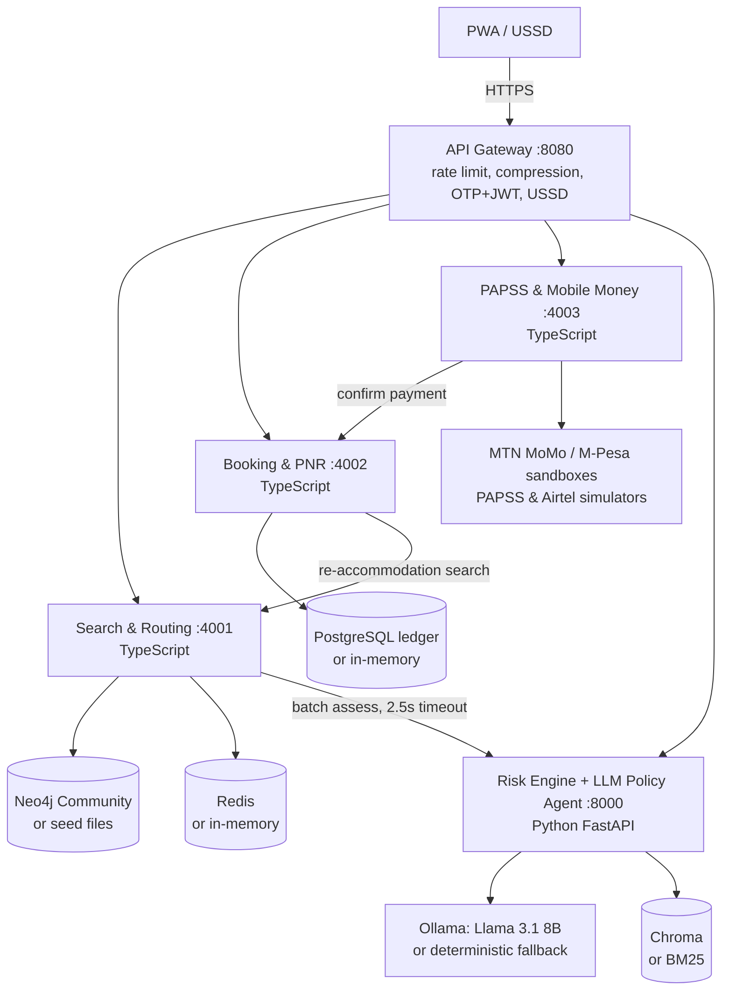

# AfriRoute: Pan-African Multi-Modal Flight & Virtual Interlining Aggregator (MVP)

An MVP of the architecture in *"Technical Architecture Document: Pan-African Multi-Modal Flight &
Virtual Interlining Aggregator"*, built **entirely on free and open-source resources**.

**The problem.** Travelling between African cities often means expensive, opaque fares, long detours
through distant hubs, and carriers that won't sell connections on each other's flights.

**What the MVP does:**

- Stitches carriers that have no codeshare into **virtual interline** itineraries, and adds **coaches**
  where they are cheaper (e.g. the Lagos–Cotonou–Lomé–Accra corridor).
- Scores every self-transfer with an **XGBoost miss-risk model** and prices optional **protection**.
  If a delay breaks a connection, the platform rebooks the traveller and pays for the hotel.
- Checks **visa / entry rules per passport**, including the hidden catch of self-transfers:
  you must *enter* the connecting country to recheck your bags.
- Shows a **Fair Price Index** and a transparent fare breakdown, with the platform fee capped at 3%.
- Lets travellers pay in **local currency** by mobile money or PAPSS. Settlement goes direct to each
  carrier's currency, with no USD double conversion.
- Works on **3G (PWA)** and on **basic phones (USSD)**.

## Architecture



Every external dependency has a fallback, so **the whole platform runs with only Node + Python**.
When an optional service is down (Neo4j, Redis, Postgres, Chroma, Ollama, or the intelligence
service itself), the platform degrades instead of failing. This is deliberate resilience for
intermittent infrastructure.

| Doc section | Where it lives |
|---|---|
| Graph route engine (nodes = airports + coach terminals, edges = scheduled services) | [services/search/src/graph.ts](services/search/src/graph.ts), [router.ts](services/search/src/router.ts), [scripts/seed-neo4j.ts](scripts/seed-neo4j.ts) |
| Segment stitching algorithm (protected / self-transfer / ground-transfer MCTs) | [services/search/src/router.ts](services/search/src/router.ts) |
| SelfTransferRiskScore (XGBoost, monotone constraints) | [services/intelligence/app/risk/](services/intelligence/app/risk/) |
| LLM function-calling agent + RAG | [services/intelligence/app/agent/](services/intelligence/app/agent/) |
| Visa rule engine (deterministic, auditable) | [services/intelligence/app/visa/rules.py](services/intelligence/app/visa/rules.py), [data/visa_rules.json](data/visa_rules.json) |
| Guaranteed Protection Wrapper (auto-rebook + hotel) | [services/booking/src/service.ts](services/booking/src/service.ts) |
| Double-entry ledger (ACID in Postgres) | [services/booking/src/repo.ts](services/booking/src/repo.ts), [sql/schema.sql](services/booking/sql/schema.sql) |
| PAPSS settlement + mobile money fallback router | [services/payment/src/](services/payment/src/) |
| USSD layer | [services/gateway/src/ussd.ts](services/gateway/src/ussd.ts) |
| PWA | [web/](web/) |

## Quick start (no Docker needed)

```bash
npm install                 # Node workspaces
npm run setup:intel         # Python venv (picks Python 3.12/3.11/3.13), installs deps, trains model
npm run dev:all             # gateway :8080, search :4001, booking :4002, payment :4003, intelligence :8000
npm run dev:web             # PWA on http://localhost:3000  (or: npm run build:web, then open http://localhost:8080)
```

To try it: search **Kigali → Lagos**, open *Price breakdown, visas & baggage*, select a self-transfer
option with protection, sign in (the dev OTP is shown on screen), pay by MTN MoMo (simulated), then
press **Simulate a 4h delay** to watch the protection wrapper rebook you.

### API examples

```bash
curl -s localhost:8080/api/search -H 'content-type: application/json' \
  -d '{"origin":"KGL","destination":"LOS","date":"2026-11-17","nationality":"RW"}'

curl -s "localhost:8080/api/visa?nationality=GH&destination=KE"

curl -s localhost:8080/api/assist/ask -H 'content-type: application/json' \
  -d '{"question":"I am Nigerian, can I take the coach from Lagos to Accra without a visa?"}'

# USSD (Africa's Talking callback format)
curl -s localhost:8080/ussd -d 'sessionId=1&phoneNumber=+250788000001&text=1*KGL*NBO*2011'

curl -s localhost:8080/api/health   # status of every service and which fallbacks are active
```

## Optional: the full free infrastructure

```bash
docker compose up -d neo4j redis postgres chroma ollama
docker compose exec ollama ollama pull llama3.1:8b      # ~4.7 GB, one-time
cp .env.example .env    # then uncomment NEO4J_URI, REDIS_URL, DATABASE_URL, CHROMA_URL, OLLAMA_URL
npm run seed:neo4j
pip install -r services/intelligence/requirements-rag.txt   # inside the venv, for Chroma
npm run dev:all
```

Or run everything in containers: `docker compose --profile app up -d --build`.

## Tests

```bash
npm test             # routing, MCT rules, multi-modal, fairness, offer signing, booking/ledger/protection
npm run test:intel   # visa rules, risk model monotonicity, assess API, agent fallback, retrieval
npm run typecheck
```

## What is real and what is simulated

| Real (working code) | Sample / simulated, to replace before production |
|---|---|
| Routing, MCT logic, ground transfers, Pareto ranking | **Schedules & fares** in `data/services.txt` are illustrative; carriers and airports are real |
| XGBoost training/inference pipeline | **Training data is synthetic**; retrain on real punctuality data (e.g. OpenSky) |
| Visa rule engine & self-transfer entry logic | **Visa rules are AI-seeded and unverified**; each rule has a confidence level |
| Signed offers, booking, double-entry ledger, protection rebooking | **Ticket issuance** is simulated; needs carrier NDC/GDS connections |
| MTN MoMo & M-Pesa sandbox clients | **PAPSS, Airtel, card** are simulators |
| OTP/JWT auth, rate limiting, USSD menu | OTP is returned in dev instead of sent by SMS |

## Road to production (in order of impact)

1. **Inventory and fares**: sign distribution agreements with 2–3 carriers on one corridor
   (e.g. Kigali–Nairobi–Lagos), then add an NDC/GDS connector behind the existing search interface.
2. **Verified visa data**: an ops review workflow on `visa_rules.json`, or a Timatic licence.
3. **Real risk data**: ingest OpenSky arrivals for JNB, NBO, ADD, LOS, KGL and others, compute real
   punctuality per carrier and route, and retrain the model.
4. **Payments**: onboard with a PAPSS participating bank; go live on MoMo and M-Pesa; persist
   payment intents in Postgres.
5. **Regulatory**: travel-agency licensing (IATA accreditation or a host agency), consumer-protection
   terms for the protection product (it may count as insurance in some markets), and data protection
   (Kenya DPA, Nigeria NDPA, Rwanda's law on personal data, POPIA).
